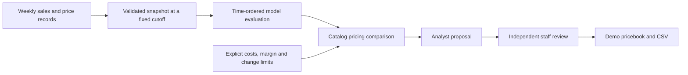

# Parts Pricing Workbench

[Open the V2 workbench](https://pricing-workbench-api.ambitiousground-6adc4ebe.centralus.azurecontainerapps.io/workbench/) · [Architecture and API](docs/pricing-phase4-api-handoff.md) · [Weekly CSV format](docs/data-contracts/weekly-pricing-v1.md)

An independent pricing prototype that follows a complete decision workflow: inspect weekly sales, freeze a data cutoff, evaluate a demand model, compare pricing strategies across the catalog, obtain a second person's review, and export an approved demo pricebook.

**Verified live, November 18, 2026:** public browsing, real sign-in, private upload, one actual bounded training run, catalog comparison, independent review and CSV export all passed cloud checks. Both the 249-series reference pricebook and the two-product practice pricebook survived an actual API restart and were reopened with both authorized accounts. See the [deployment record](docs/pricing-phase5-deployment-2026-11-18.md) for evidence and limits.

## Start with the public example

No account is needed to inspect the saved **249-series OJ reference**. Follow the stages across the page:

1. **Data:** inspect the catalog, sales concentration, observed price changes and gaps in recorded history.
2. **Model:** compare the saved Poisson model with simple forecasting baselines and inspect its held-out historical results.
3. **Pricing:** inspect how assumed costs, minimum margin and a permitted price-change range constrain each decision. The teaching scenario proposes 20 changes and holds the other 229 series.
4. **Review:** open individual rows to see the selected price, unchanged-price alternative, reasons and evidence.

This public example is a curated saved result, not a new training run. The underlying historical OJ data are real; the example's costs and business constraints are explicitly assumed. OJ prices and sales retain their source-scale labels because a defensible currency/package conversion is unavailable.

## Private workflow

Private analyst and reviewer accounts are provisioned by the owner. A successful Firebase login alone does not grant workspace access. Credentials are never published in this repository.

The implemented workflow supports uploading a validated weekly CSV, creating an immutable cutoff snapshot, requesting a bounded training job, selecting a compatible saved model, comparing the full catalog, and saving a proposal. A different authorized reviewer must resolve the complete proposal before it can be published to the **demo ledger** and downloaded as CSV. A published demo pricebook does not update an ERP or send real prices to customers.

Use the analyst account to prepare and **Send for review**, then sign out and use the reviewer account to **Approve selected** and **Publish to Demo ledger**. Both roles can reopen the saved results. The owner keeps account details in a private local file; there is no public password or browser role-switching bypass.

For a small practice input, download the clearly labeled [synthetic 100-week CSV](workbench/downloads/synthetic-weekly-teaching.csv) and its [source description](workbench/downloads/synthetic-weekly-teaching.json). It contains two invented products and synthetic USD values. Use cutoff **100**. This fixture tests the workflow; it is not real commercial data or evidence of model quality.

## How the engine works



The model uses historical price, advertising and time features. Its shared brand-level response lets sparse store/product series borrow information from more frequently observed series. This is useful for exploring the long-tail problem, but does not establish the causal effect of changing a price. Forecasting performance, price-response identification and realized profit are separate questions.

The pricing engine compares feasible candidates with an unchanged-price alternative. It enforces margin and price-change limits, retains holds and excluded cases, and records why a proposal was selected. Missing information is kept visible. Calendar seasonality requires a defensible calendar mapping; future promotions and inventory must be provided or explicitly assumed. This version does not optimize substitution between products or promise that every relevant commercial factor is available.

The frozen reference model's historical confirmation MAE was **7,698.47**, versus **11,921.55** for the recent-mean baseline, conditional on realized prices and advertising. Those numbers are source-scale forecast errors, not dollars or measured profit uplift. [Reference evaluation and limitations](docs/pricing-phase2-handoff.md).

## Technology and boundaries

- **Python / scikit-learn:** validated data processing, time-ordered forecasting evaluation and bounded pricing calculations.
- **FastAPI and browser JavaScript:** the same-origin workbench and private HTTP API.
- **Firebase Authentication:** identity; server-owned workspace membership determines permissions.
- **Azure Container Apps:** API with min 0/max 1 replica, and a separate manual training job.
- **Azure Blob Storage and Tables:** private inputs/results, versioned plans, review history and the demo ledger; separate API and worker managed identities.

No LLM API is called by the pricing workflow. This is not a Palantir integration, a copy of International's internal engine, or a production automotive-parts system. The OJ reference is a retail research proxy. No 400,000-SKU capacity or causal business-impact claim is made.

## Run checks locally

Use CPython **3.13.12** and the committed dependency lock:

```bash
uv sync --locked --group test
uv run --locked --group test python -m unittest discover -s tests/web_backend
uv run --locked --group test python -m unittest discover -s tests/training
```

These suites use synthetic inputs and mocked fitting/provider operations. They do not launch a real cloud training job. The production service entrypoint is:

```bash
uv run --locked uvicorn pricing_web.api:production_app --factory --host 0.0.0.0 --port 8000 --workers 1
```

It requires the explicit private Firebase/Azure configuration and managed identity described in the [API handoff](docs/pricing-phase4-api-handoff.md). It has no automatic developer credential or local-storage fallback. See [deployment instructions](deploy/README.md) and [the bounded training design](docs/pricing-phase4-training-handoff.md).

The earlier UCI gift-retail browser-only experiment is retained under `web/`; its [Chinese walkthrough](docs/learn.zh.md) describes that earlier version. It is separate from the V2 OJ model and private workflow. Raw datasets, fitted artifacts and account secrets are excluded from Git and the code-only container image. See [source attribution](THIRD_PARTY.md).
